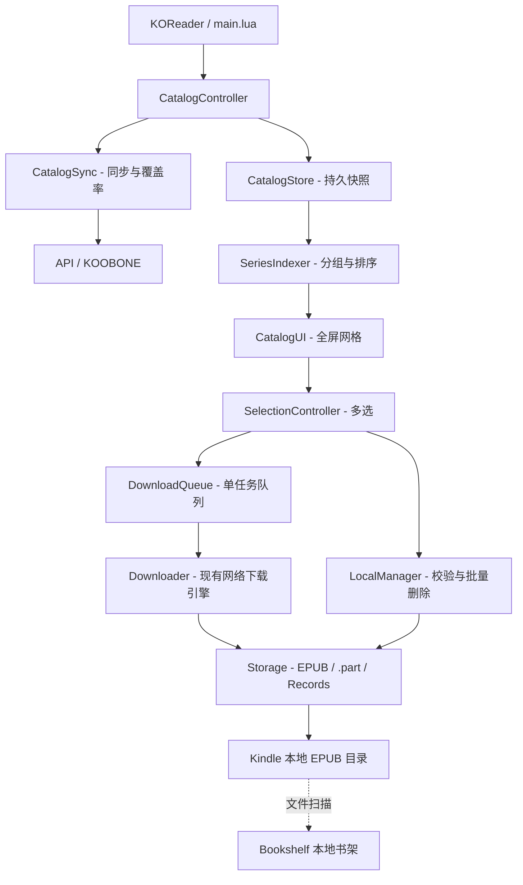

# KooComic Next — KOOBONE 漫画库管理器重构规格说明

> 状态：Draft for implementation review｜Spec 版本：1.0｜编写日期：2026-10-12  
> 代码基线：`jackchensky/KooComic`，`main` 分支当前可见源码；目标运行时：KOReader，优先 Kindle Colorsoft。  
> 本文是**目标版本规格**，不是已实现功能或服务器能力确认报告。特别是 KOOBONE 完整分页机制尚未验证。

## 0. 决策摘要

**产品定位：KooComic 是远程漫画发现、同步、下载和本地批量管理中心；Bookshelf 是本地阅读入口。** 两者独立，KooComic 不注册 Bookshelf 远程 Source，不修改 Bookshelf 源码，不把 KOOBONE 云端列表混入本地书架。二者通过 KOReader 能扫描到的本地 EPUB 文件目录进行松耦合集成。

必做能力：①完整书库同步（前提：确认远端分页/全量请求能力）；②按照系列虚拟分组、卷排序；③更紧凑的全屏墨水屏封面 UI；④可暂停/取消的串行批量下载队列；⑤按卷、按系列及多选删除本地文件；⑥离线缓存与失败恢复；⑦既有下载路径和阅读记录兼容。

**强制约束**：远程书籍记录与本地下载文件为两个独立概念；删除本地副本绝不调用云端删除；不根据 KOOBONE 阅读进度自动删除；不默认移动已下载 EPUB；绝不将分页猜测当作确认事实；批量任务不得静默吞掉失败。

## 1. 现有代码审计与复用边界

| 文件/模块 | 现状（已核对源码） | 新版本处理 |
|---|---|---|
| `koobone/api.lua` | `Api:library(limit)` 调用 `/vol_list.php?u=<uin>&by=time&limit=%d`，默认 28；网络层及下载接口已有 | 复用网络/认证逻辑；增加可验证的分页能力探测、数据归一化、超时与错误类型；不能直接假定 `offset` 可用 |
| `koobone/library.lua` | `refresh()` 固定 `self.api:library(28)`；`freshItem()` 再拉 28 条定位下载地址 | 拆分 `syncCatalog()`、`findItem()`、`resolveDownloadUrl()`；稳定 ID 索引；目录级缓存；签名地址即时刷新 |
| `koobone/downloader.lua` | `self.active` 限制单任务；一次下载有进度、`.part`、完成/失败记录 | 保留单下载引擎，抽出 `downloadOne(job, callbacks)`；新增持久串行队列和会话内状态机 |
| `koobone/storage.lua` | 已有 `deleteItem()`、`deleteRecordFiles()`、失效记录清理；`itemKey` 首选 `file_md5`；路径主要取书名 | 扩充本地索引、路径解析、目录安全、批量删除；保留现有路径兼容；以 `record.path` 作为优先打开路径 |
| `koobone/cover_cache.lua` | 有本地封面下载及缓存，能校验图片魔数 | 复用；在列表可视区域内按需加载并限制缓存和刷新频率 |
| `koobone/ui/bookshelf.lua` | 已有搜索、标题/进度排序、已下载/未下载筛选等状态 | 改为 catalog 控制器，支持根目录/系列/筛选/多选/下载队列状态 |
| `koobone/ui/bookshelf_grid.lua` | 当前竖屏默认 3×2、横屏 4×2；高 72dp 标题栏、52dp 工具栏、46dp 翻页栏、72dp 底部导航；长按与单击同效果 | 重构为紧凑全屏布局；长按进入多选；支持系列文件夹卡片、状态徽标、动态行数 |
| `koobone/ui/metrics.lua` | 行列配置当前限制 1–3 行 | 扩充依据真实屏幕尺寸计算，不预设 Colorsoft 恒为某固定格数 |
| `koobone/ui/book_detail.lua` | 可下载、打开、删除本地 EPUB、删除残留 `.part` | 保留单本动作；提供加入队列、删除后回退/刷新；避免固定推断文件名 |
| `koobone/ui/downloads.lua` | 下载历史、删除单本、清理失效记录及临时文件 | 明确区分“排队中任务”和“历史记录”；新增队列管理、批量操作、总空间统计 |
| `koobone/settings.lua` | `schema_version=3`；保存账号、下载记录、更新设置、UI 行列 | 迁移到 v4；兼容旧字段，增加 `catalog`、`queue` 和 UI 新参数 |
| `main.lua` | 负责初始化认证、书库、下载器和 UI；`openBookshelf()` 验证登录后刷新 | 注册新控制器与事件；启动先显示缓存、异步调度联网（仅在实际运行时可保证不阻塞前提下） |
| `spec/*.lua` | 已有认证、书架、下载、存储、设置迁移等回归测试 | 原测试必须保持通过，并补充下一章节的测试矩阵 |

**关于 Bookshelf**：本规格仅参考其全屏、封面网格、间距和分页交互，不直接复制其代码、样式或依赖，也不宣称 KooComic 安装后自动继承 Bookshelf 特性。

## 2. 用户任务与验收场景

| 场景 | 用户操作 | 应见结果 |
|---|---|---|
| 初次打开 | 登录 KOOBONE，进入 KooComic | 先显示可用缓存/加载状态；成功同步后显示所有**已被真实获取**的系列与卷；展示同步完整性 |
| 选漫画 | 点击系列封面 | 进入系列卷列表，按卷序排列，单卷可看详情 |
| 一次下载整套 | 系列内选择“下载未下载卷” | 生成队列，按顺序下载，已存在文件自动跳过 |
| 跨系列挑选 | 长按进入多选，勾选漫画，点下载 | 选中数量、预计容量、已有文件和空闲空间检查；确认后入队 |
| 下载期间退出视图 | 返回漫画库、切换应用视图 | 队列进度与状态不丢失；**不承诺操作系统级后台下载**，真实执行能力须经 Kindle 机型测试 |
| 查看已读并删除 | 在 Bookshelf 阅读结束，使用 Bookshelf 删除本地 EPUB | 本地书架刷新后消失；KooComic 刷新本地状态后显示“未下载”，仍可重下 |
| 批量腾空间 | KooComic 筛选“已下载”，勾选或选整个系列删除 | 二次确认展示文件数/总空间；只删本地文件，不触发云端删除；输出成功/失败汇总 |
| 无网络 | 打开 KooComic | 浏览已缓存的系列/封面/状态；下载操作提示需联网，不清空旧列表 |
| 扩容升级 | 从现有 KooComic 升级安装 | 已下载文件路径、历史记录、账号与更新设置不受破坏；无需重新下载 |

## 3. 产品与信息架构

```text
KooComic / 远程漫画库
├─ 主书库 / 系列（默认）
│  ├─ 系列 A  [封面] [卷数] [已下载数]
│  │  ├─ 第 01 卷 ... 状态/操作
│  │  └─ 第 02 卷 ... 状态/操作
│  ├─ 系列 B ...
│  └─ 未分类（没有可用系列名的漫画，不能把所有未知书籍强制合并为一个系列）
├─ 全部单卷（切换视图）
├─ 已下载（过滤）
├─ 下载队列（运行任务/排队任务/失败重试）
├─ 本地管理（按系列清理/多选删除/空间统计）
└─ 更多（手动同步、账号、设置、帮助/诊断）

Bookshelf / 本地书架（完全独立）
└─ 已存在的 EPUB/其他电子书 → 阅读/进度/单本删除
```

**层级原则**：同一份 Catalog 提供“按系列/全部单卷/已下载”等不同投影视图，不复制书籍元数据。系列目录默认是 UI 虚拟分组，不对应物理磁盘目录。

### 3.1 一级导航

顶部仅保留 36–48dp 紧凑标题条（返回或目录、当前名称、同步/搜索/更多图标）；不出现 Bookshelf 的“当前在读”大型 Hero 信息区。底部采用轻量窄操作条或覆盖式操作菜单，避免持续占据 72dp；页码放在紧凑页脚。多选时操作栏替换导航栏。应提供可访问的触控目标（约 40dp 以上或按 KOReader 实测适配），不牺牲可点击性换空间。

### 3.2 关键页面行为

**系列首页**：卡片显示系列封面、标题、总卷数、已下载卷数；最近更新只在有可信时间字段时显示。搜索支持系列名及作者；可筛选“有本地卷”“全部未下载”“最近同步”。

**系列内卷列表**：按解析后的数字卷号自然排序，其次原始排序字段；支持封面/列表切换（MVP 可先封面）；顶部显示“下载未下载卷”“管理已下载卷”。单击进详情，长按切换选中。

**全部单卷**：保留旧 KooComic 操作路径，供系列信息缺失或不愿按系列浏览的用户使用。

**下载中心**：展示 `运行中 / 等待中 / 失败 / 已完成`，有“暂停队列”“继续”“取消待处理”“重试失败”；总任务数/完成数/下载字节及当前卷名。已完成历史仍在已有管理页可查。

**本地管理**：已下载数、已确认文件大小总和；可以按系列、多选删除。所有删除都为显式点击和二次确认；无自动已读删除。

## 4. 远程书库全量同步 — 最高优先级和发布门槛

当前服务器请求固定 28；**28 是客户端传入的 `limit`，不能由此断定服务器最多只提供 28 本，也不能断定支持 `offset`、`page` 或超大 `limit`**。开发分两段：先做安全探测，再决定可支持的同步方式。

### 4.1 能力探测与证据要求

在用户本人已授权登录的环境中，使用不会修改服务器数据的只读请求，记录（脱敏）响应数量、稳定 ID、有无下一页、服务器报错类别和排序；不记录 Cookie、签名 `file_url` 和私人书库完整内容到公开日志。

- 先保留基线 `limit=28`，测 `limit=50/100` 是否确实增加不同记录，识别硬限制。
- 如实际响应或网页客户端显示页码/游标，再分别测试被观测到的参数，如 `offset` / `page`；不能凭空发明参数的语义。
- 用前后两页稳定 ID 交集、总数与响应排序检验真实分页，而不只看 HTTP 200。
- 测数据增删、同名、重复、卷排序、字段缺失、过期会话以及限流/网络错误。
- 若服务端没有公开可行的完整列举方式，则标记 `catalog_coverage="partial"`；不宣传“全量”；不通过无界面外爬虫或绕过鉴权弥补。

### 4.2 同步状态机

`EMPTY -> CACHE_READY -> SYNCING -> { COMPLETE | PARTIAL | ERROR }`。

- **缓存优先**：启动后显示上次完整成功同步的快照；加载状态与时间必须可见。
- **临时构建**：分页结果写入临时快照，去重和校验完成后才原子替换正式快照；失败不能覆盖旧数据。
- **何为完整**：由服务器可信 `total` 或明确无下一页/短页结束条件及稳定分页验证共同确定；固定 28 条不能判定完成。
- **重复/漂移**：稳定 ID 去重；排序不稳定时先记录异常，必要时重复抓取对比，达到上限后标记 partial，不循环无限请求。
- **手动同步**：始终可用。再次进入可按 `sync_interval_minutes` 节流；默认进页面检测，短间隔不重复联网。
- **远程缺失**：一次 partial/failed 不能判断书籍已从云端删除；仅在完整可信快照里才更新远端消失状态。
- **签名 URL**：不长期保存 `file_url` 到持久 Catalog；下载当时向最新快照或经确认的单书接口重新解析。如果远端只有全量列表接口，每本下载都全量重抓不可接受，需有短期页面索引或其他已经验证的刷新策略。

### 4.3 核心数据契约（建议）

```lua
CatalogEntry = {
  id = "vol:<vol_id or stable fallback>", -- 与账号作用域组合后唯一
  account_id = "<uin>",
  source = { vol_id = "...", file_md5 = "..." },
  title = "漫画名称",
  author = "作者",
  series_key = "normalized:<name>",
  series_title = "原系列名",
  volume_num = 12,             -- 能解析时才写入
  volume_label = "12.5",      -- 特别篇/小数卷不强制整型
  cover_url = "...",           -- 普通封面地址可缓存
  remote_size = 12345678,
  remote_progress = { current = 0, total = 100 },
  sort_rank = 0,
}

LocalRecord = {
  key = "stable-entry-id",       -- 一条 Catalog 可关联到本地某版本文件
  filepath = "/.../KOOBONE/xxx.epub",
  size = 12345678,
  state = "downloaded",         -- 源于文件实际状态
  original_path = nil,
}
```

`file_md5` 可能是**文件版本哈希**而非作品恒定 ID，不能把它等同为跨版本卷 ID；优先经过验证稳定的 `vol_id`，否则按账号+可用标识降级，并定义哈希变动的合并规则。缺乏稳定字段时宁愿标记冲突要求用户选择，不自动覆盖同名本地文件。

## 5. 系列分组与排序

1. 优先取可信的 `vol_series`；空值视为未分类。标题正规化仅做 Unicode 空白规整、首尾空格清除和用于检索的大小写处理，不默认剥离字幕、副标题或版本信息。
2. 系列主键 `account_id + normalized_series_name`，同名不同作者可结合可信作者或后端系列 ID 进一步区分；不能简单按书名前缀匹配。
3. 排序优先可信 `vol_index` / `volume` / `vol_no`，需支持数值、`01`、`12.5`、上下卷、外传/番外；无法解析的尾部按字面自然顺序稳定排序。
4. 系列封面优先第一卷的有效缓存封面；未来可支持最近卷，但默认封面应稳定不跳动。
5. 总卷数来自当前**已同步覆盖**的记录；partial 时显示“已发现 N 卷”，不宣称云端真实总数。
6. 目录深度为一层系列 → 单卷；不要自动按作者/出版社套娃。
7. 相同作品的不同版本、重新制版、重复上传均保留独立记录并可展示差异，不能误去重。

## 6. 下载队列与批量下载

### 6.1 核心约束

- **串行是第一版唯一默认并发度，固定 `max_concurrent=1`**：控制 Kindle 内存、HTTP 连接和墨水屏刷新，减少服务器压力。
- 不必为每本显示“下载完成，立即打开”弹窗；批量任务结束仅弹一次可选摘要。
- 同一账号同一本同一版本只允许一个待执行任务；“下载整个系列”只增加未下载且不在队列的卷。
- 队列任务只保存稳定 ID、请求元数据、错误状态；禁止持久化临时签名 `file_url` 和 Cookie。

### 6.2 状态机

```text
queued ──> preparing ──> downloading ──> verifying ──> completed
  │           │               │              │
  └─> cancelled <──────────────┴──────────────┘
              │
        transient_failure ──> retry_wait ──> queued
              │
         permanent_failure
```

额外队列状态 `running / paused / idle`，与单任务状态分开。`paused` 语义默认是**停止启动下一个任务**；当前正在传输的暂停/中断能力必须经过运行时验证，若无法中断则 UI 清晰提示“当前卷完成后暂停”，不能假装已停止网络传输。

### 6.3 运行与恢复

- `DownloadQueue:add(items, mode)` 去重并返回 `{accepted, skipped_downloaded, skipped_queued, rejected}`。
- `runNext()` 在完成/失败回调后调度下一项，防止递归栈增长。
- 弱网错误最多自动重试 2 次，指数退避加抖动；401/403 按认证或签名过期单独处理，必要时提示重新登录；403 不应盲重试。
- 启动恢复将上次的 `preparing/downloading/verifying` 标记为 `interrupted`，并按实际 `.part` 文件决定能否安全重下。
- **断点续传非必做**：仅当服务器支持并实际返回 `206`、正确 `Content-Range`、ETag/校验策略时启用，否则从头写入临时文件，绝不把 `200` 响应追加到旧 `.part`。
- 成功应经过文件大小、EPUB/ZIP 基本可读性校验后原子重命名；可获得可信 hash 时再校验 hash。不能仅以“HTTP 返回成功”算完成。
- 下载目录空间不足时拒绝入队或暂停队列，估算至少所选剩余字节+安全缓冲。未知文件大小时提示估算不完整；具体空闲空间 API 需设备适配。
- 下载时尽量减少全量书库重抓；先查索引，过期时对必需范围刷新并更新稳定 ID 映射。

### 6.4 使用界面

- 长按单卷选中，多选底栏 `[已选 N] [下载] [删除本地] [取消]`。
- 系列页提供“下载未下载卷（X 卷，约 Y MB）”。
- 任务列表支持单个取消、失败重试、移出队列；已完成文件不因移出队列而删除。
- 显示总进度：`完成 6 / 20 · 当前第 7 卷 · 52%`；总体字节百分比仅在总大小均可信时展示。
- 下载过程中封面网格最多按阶段或显著百分比更新，不以每个 TCP 块刷新整屏。

## 7. 删除与本地空间管理

### 7.1 谁负责删除

- **Bookshelf**：阅读后顺手单本删除；这一流程保持原样，不由 KooComic 接管。
- **KooComic**：单本、整系列和跨系列多选本地删除，以及清理失败/残留 `.part` 和失效记录。
- 两插件互不调用对方 API；KooComic 进入“已下载”视图、执行批量操作或在后台事件可用时重新 `stat` 文件状态；Bookshelf 依据自己对磁盘的扫描/刷新显示本地结果。

### 7.2 删除范围与确认

| 操作 | 删除 EPUB | 删除 `.part` | 删除远程记录 | 清除 KOReader sidecar/阅读进度 |
|---|---|---|---|---|
| 单本删除本地 | 是 | 同一项残留可选，提示 | 否 | **默认否** |
| 系列批量删除 | 是（所选已下载卷） | 默认否，单独“清理临时文件” | 否 | **默认否** |
| 清理下载残留 | 否 | 是 | 否 | 否 |
| 清理失效下载索引 | 否 | 否 | 否 | 否 |

删除确认须列 `卷数、真实存在的文件数、可释放字节数、示例文件名` 和“不会删除云端漫画”。批量删除逐个执行，遇到失败继续处理余项；最终返回成功数、失败数、释放字节和可定位错误。正在写入的文件禁止被删除；正在阅读的文件如可检测为打开中则拒绝或提示先关闭阅读器。

### 7.3 路径安全与阅读进度

- 删除路径必须出自经过验证的 `LocalRecord` 或既有 download record，规范化路径并验证位于用户配置的下载根目录；禁止对任意父目录、符号链接目录、`..` 跳转路径操作。
- 除非确认是插件自己管理的 `.part`，**只允许删除已索引的 EPUB 文件**，不做递归目录清空。
- 删除默认保留 `.sdr`、KOReader 阅读历史和缓存；但同一路径重新下载后能否恢复进度需真机验证，不能保证。
- `record.path` 是比重新拼接标题更可靠的打开/删除路径。现有 `BookDetail` 打开时使用 `storage:itemPath(item)`，应改为通过 `Storage:resolveLocalPath(item)` 查询历史记录与实际文件，避免旧路径失效。
- 用户通过 Bookshelf 删除后，KooComic 的下载记录可能仍标记 `complete`，但状态显示必须以 `file exists` 为准；可在非阻塞扫描后清理无效记录。

## 8. 实体文件目录策略与兼容性

**MVP 默认不搬动文件**。现有 `itemPath()` 通过安全化的 `vol_name` 生成平铺 `KOOBONE/*.epub`。直接改为 `KOOBONE/<系列>/<卷>.epub` 可能让 KOReader 将它当成新书，丢失原路径关联，且重名卷会冲突。

- 第一阶段只建立虚拟系列文件夹；已下载的 EPUB 保留原路径。
- `Storage:resolveLocalPath()`：优先可信记录路径，其次原版路径，再依据未来新路径；一旦确认更新记录，所有打开/删除入口统一使用。
- 新下载文件可先维持平铺路径，但必须解决不同漫画同名导致的覆盖/误判：文件名安全名后缀加短稳定 ID（新下载），并保持兼容老命名。
- 实体系列目录为可选 P2 特性；开启时**只影响未来下载**，旧文件需经用户明确同意的单独迁移流程。迁移前导出路径映射、检查冲突/空间，移动后不擅自删除 `.sdr`；需说明阅读进度关联风险。
- 目录必须可被 Bookshelf 当前本地源检索：确认下载根目录位于 KOReader 配置的 `home_dir` 扫描范围及扫描深度内；必要时提供“打开下载目录/设置下载路径”指引。

## 9. UI 设计规范（参考 Bookshelf 的手感，不依赖 Bookshelf）

### 9.1 布局

- 全屏内容，不显示大型“当前在读”Hero；不显示持续占高度的账号信息横幅。
- 紧凑顶部栏 + 可折叠过滤栏 + 自适应封面网格 + 窄翻页/状态行；操作藏入短底栏或溢出菜单。
- 不硬编码 3×2：按设备像素、实际字体和封面比例、横竖屏动态算可容纳行数；目标是在 Colorsoft 上比旧版 3×2 显示更多有意义的封面，但以点击目标与标题可读性为前提。
- 统一网格间距、卡片比例；封面优先完整保留纵横比，允许留白而不是拉伸；占位封面有清晰标题。
- 顶部系列路径 `漫画库 / 剑风传奇`；点路径返回上一层，系统 Back/右滑返回一致。
- 翻页左/右滑与点击箭头一致；在系列首页点击文件夹进入下一层，避免把同一个手势同时解释为进目录和翻页。

### 9.2 墨水屏性能

- 灰阶为主，只用少量高对比强调色/黑白反转表达选择与危险操作；在 Colorsoft 上确保灰阶也能辨认。
- 每页仅解码可见封面和少量预取项；避免每次页码切换都重新请求相同封面。
- 网络/下载进度优先局部刷新，使用 KOReader 已有 UIManager 刷新机制；全刷仅在设备要求或残影明显时触发。
- 长按反馈和多选状态须明显，但不能依靠颜色作唯一状态信号。
- 提供列表回退视图，减少低内存或封面异常带来的不可用风险。

### 9.3 状态文字

`云端可用 / 未下载`、`已下载`、`排队中`、`下载中`、`失败`、`文件丢失`、`同步不完整`；远端阅读 `last_readpage/count_page` 明确标记为 KOOBONE 进度，不等同 KOReader 进度。

## 10. 架构、事件与数据流



### 10.1 建议新增文件

```text
koocomic.koplugin/koobone/
├── catalog_store.lua        # 按 account_id 持久化成功快照，原子写入和恢复
├── catalog_sync.lua         # 服务器分页能力、完整性判定、同步流程
├── series_index.lua         # 纯函数：归一化、分组、卷顺序、检索
├── download_queue.lua       # 队列持久化、调度、去重、重试策略
├── local_manager.lua        # 批量删除、空间统计、路径白名单
└── ui/
    ├── series_view.lua      # 系列卡片/目录导航（或扩展现有 grid）
    ├── selection_bar.lua    # 多选及确认
    └── queue_view.lua       # 活跃队列及失败重试（可以扩展 downloads.lua）
```

### 10.2 核心接口草案

```lua
CatalogSync:probeCapabilities()                -- {mode, page_limit, verified, evidence}
CatalogSync:sync(on_progress, on_done)           -- 完整性及错误明确返回
CatalogStore:load(account_id)                  -- entries, meta
CatalogStore:commit(snapshot, meta)            -- 完成验证后原子替换
SeriesIndexer:group(entries)                   -- group[] + ungrouped[]
Storage:resolveLocalPath(item)                 -- filepath|nil, status
Storage:verifyLocalPaths(items)                -- 逐项 stat / 防路径逃逸
DownloadQueue:add(items)                       -- accepted/skipped/rejected
DownloadQueue:pauseAfterCurrent()
DownloadQueue:resume()
DownloadQueue:cancel(job_id)
DownloadQueue:retry(job_id)
LocalManager:previewDelete(items)              -- count/bytes/invalid/in_use
LocalManager:delete(items, on_progress)        -- per-file results
```

**线程/事件规则**：网络调用不得直接发生在网格渲染 `paintTo`、`_build` 或 `visibleItems` 中；队列驱动不能在 UI 绘制回调中发起同步下载。`UIManager:scheduleIn()` 只是延迟执行，不等于异步线程：必须实测现有 `api:download()` 的阻塞行为和 KOReader 可用协作式网络方案。若无法可靠实现非阻塞，MVP 应明确采用“前台队列运行、用户保持下载界面”的降级，不能伪装后台下载。

## 11. 缓存、配置、升级

### 11.1 配置草案（schema_version=4）

```lua
settings.catalog = {
  sync_on_open = true,
  sync_interval_minutes = 15,
  view_mode = "series",        -- series / volumes
  sort_series = "name",        -- name / recent（有数据时）
  show_unclassified = true,
}
settings.queue = {
  paused = false,
  retry_limit = 2,
  download_wifi_only = false,  -- 不支持检测 Wi-Fi 类型时不得假装生效
}
settings.ui = {
  compact_mode = true,
  show_filter_bar = false,
  layout = "auto",
  -- 保留 portrait_columns 等旧项作回退/显式手动配置
}
```

- 账号和会话数据保持既有保存方式；`catalog_store` 必须按 `uin` 分区以防换号看到别人的私有书库。
- 原始 `download.records` 保存格式与键必须兼容；migration 仅在验证成功后写入升级标记。
- `queue` 快照落盘采用临时文件+原子 rename；重启不能把旧 `running` 标记为继续运行。
- 账号退出默认不删除本地书籍；缓存可保留在本机，但退出后不应未经鉴权展示前账号私有远程书库，可提供“清除此账号缓存”操作。
- 设置文件不保存临时 `file_url`，日志不保存密码、会话 Cookie 和签名查询参数。

### 11.2 版本与兼容

- 该改造属于大幅产品功能变更，建议开发分支名 `feat/catalog-manager-vnext`，对外版本号由维护者按兼容策略决定（不在本 spec 虚构正式 release 版本）。
- 继续保留 `main.lua` 入口、已有快捷菜单和更新机制；不得破坏 `plugin_version.lua` 的升级检查与发行 ZIP 路径。
- 旧下载文件路径不自动搬迁；安装包可覆盖旧代码但不可覆盖用户 Settings 和漫画文件。
- 缺网络、缺封面、服务器协议变化时进入可解释的降级状态，而不是退出 KOReader。

## 12. 开发阶段、依赖与阻塞条件

| 阶段 | 任务 | 完成定义/阻塞 |
|---|---|---|
| P0 · 基线与探测 | 固定旧版回归基线；验证 KOOBONE 完整分页能力；测试书籍 ID 稳定性、file_url 更新方式 | 得到可重复的脱敏探测报告；若不能可靠全量则不得写“全量支持” |
| P1 · 模型与缓存 | CatalogEntry/LocalRecord、系列分组、离线缓存、原子快照、下载路径解析 | 单测通过；无网络可读旧快照；重名不混卷；旧文件可正常打开 |
| P2 · UI | 系列首页/卷详情、紧凑全屏布局、动态格数、搜索/过滤/滑动、多选 | Colorsoft 竖/横屏通过交互验收，阅读不卡顿，无裁切重叠 |
| P3 · 批量下载 | 抽象单下载任务 + 串行队列、取消/重试/恢复/空间检查 | 20 卷任务稳定完成；中断重启状态准确；失败不破坏已完成文件 |
| P4 · 批量删除 | 单卷/系列/多选删除、路径防护、空间统计、Bookshelf 本地同步验证 | 云端记录不变，阅读资料默认保留；刷新 Bookshelf 正确显示剩余文件 |
| P5 · 真机发布 | 回归/性能/文档/安装升级/回滚验证 | 关键阻塞项全部通过，且对部分功能明确标注服务端限制 |

建议优先 P0→P1→P2，随后 P3/P4；P0 可以与纯本地的分组/布局工作并行，但“完整同步”必须以 P0 结论为准。

## 13. 测试矩阵与验收准则

### 13.1 功能与数据

- [ ] 远端超过 28 卷时，能够获得**所有经服务端确认可枚举**的卷；分页或无分页支持的证据写入测试报告。
- [ ] 28/29/56/57、本数为 0、最后页少于一整页、重复页、服务端排序变化均正确处理。
- [ ] 服务器只支持 28 条时明确显示 `partial`，不能无尽重试或展示虚假的“已同步全部”。
- [ ] 已登录 A 账号 → 退出 → 登录 B 账号，不泄漏 A 的远程目录；不误删 A 留在本地的文件。
- [ ] 同系列 1、2、10、12.5、特别篇排序合理；卷号缺失时稳定、不崩溃。
- [ ] 重名不同系列、同名不同作者、同一卷多个上传版本不覆盖本地 EPUB。
- [ ] 冷启动离线、同步中断、封面 404、异常 JSON、Cookie 过期均可回退到可用 UI。

### 13.2 下载

- [ ] 选 20 卷只产生 20 个唯一任务（重复入队不增加任务）。
- [ ] 已下载卷正确跳过；部分下载成功、部分失败，最终显示准确汇总。
- [ ] 网络掉线时不把半包 `.part` 误标记为完成。
- [ ] 重启 KOReader 后 queued/failed/interrupted 状态恢复可解释；不自动无提示复发 20 个请求。
- [ ] 空间不足、目标目录不可写、下载地址过期、重定向、响应大小异常均有正确分类。
- [ ] “暂停队列”含义与实际运行一致；取消等待任务立即生效。
- [ ] 单卷下载仍能打开，不破坏旧有 UX。

### 13.3 删除与本地文件

- [ ] 删除前展示文件数和真实字节数；执行后不触发任何 KOOBONE 云端删除请求。
- [ ] 通过 Bookshelf 删除某卷，KooComic 再次进入/扫描后显示未下载。
- [ ] KooComic 删除后 Bookshelf 重新扫描/刷新不再显示对应本地文件。
- [ ] 删除操作不会进入下载根目录之外，不会递归删除文件夹，不会跟随符号链接逃逸。
- [ ] 有一个文件删除失败时剩余文件继续处理，汇总准确。
- [ ] 默认保留 `.sdr` 和阅读历史；重下同路径的阅读位置行为真机记录，不把未经验证的恢复称为保证。
- [ ] 旧版本下载文件和新版本下载文件都可识别、可打开、可删除。

### 13.4 UI / Kindle 真机

- [ ] Colorsoft 竖屏、横屏、旋转、夜间模式和字号改变，均无按钮溢出、封面伸长或底部 UI 被裁切。
- [ ] 目录导航、系统返回、滑动翻页、多选长按互不冲突。
- [ ] 断网/缓存加载/下载时返回、下载后进入 Bookshelf 均可操作，不发生 KOReader 崩溃。
- [ ] 100/500/1000 条合成目录的分组、翻页、内存与首屏耗时有实测记录（阈值由基线设备确定）。
- [ ] 全屏至少较当前 3×2 方案显著降低无效顶部/底部占用；若无法多显示一行，应说明字体/封面比例导致的取舍。

### 13.5 发布阻塞（Release Gates）

**必须全部满足**：旧测试无回归；真实分页能力边界已标注；单本下载仍成功；批量下载可靠完成与恢复；批量删除不越界；既有 EPUB 可打开且不自动迁移；退出账号后隐私隔离正确；Colorsoft 真机稳定运行；更新/回滚可恢复。

## 14. 非目标与推迟项

- 不重写 Bookshelf、不注册云端 Source、不从 KooComic 直接接管 Bookshelf 的 UI 或阅读进度。
- 不自动同步 KOOBONE ↔ KOReader 阅读进度。
- 不把“已读”当作自动清理依据。
- 不强制改成本地实体系列目录；未来可在用户许可下提供迁移器。
- 不实现全站搜索/抓取、未经授权的漫画下载或服务端绕权。
- 不承诺熄屏、KOReader 关闭后仍能后台下载。
- 不将服务端未验证分页、真正断点续传、系统级后台任务写进已实现清单。

## 15. 需要 P0 实测并记录的开放问题

1. `/vol_list.php` 是否有真实可用的下一页能力？支持的参数、页大小上限、终止条件、重复页与排序行为是什么？
2. `vol_id` / `file_md5` 在同卷更新/重新生成 EPUB 后的稳定性如何？`vol_series`、`vol_index` 等字段有多少覆盖率？
3. 能否通过指定单卷 ID 获取新签名 `file_url`？若不能，一次全量刷新成本是多少？
4. KOReader on Colorsoft 的 UIManager/network 实际阻塞和下载取消响应时延如何？
5. KooComic 原下载目录是否确实落在 Bookshelf 当前 home/扫描深度范围内？
6. Bookshelf 从界面删除文件后 KOReader sidecar/read history 实际保留规则是什么？不同删除入口是否一致？
7. Colorsoft 可用屏高、前景 UI 的安全区及最佳封面卡片尺寸的真机测量结果是什么？

## 16. 提交给 Codex 的实施约束

建议先让 Codex 以本文件为唯一产品规格，并执行：

> 先阅读整个仓库以及本 SPEC，输出“源码现状 → 需求 → 拟改模块 → 风险 → 测试”的 traceability 矩阵。第一轮只实施 P0 的远端分页能力探测辅助和 P1 的纯数据模型/目录分组及路径解析，保持原界面与单卷下载可用，不要顺手重构认证/更新机制。任何服务器能力未经真实验证都要用 feature flag 标记，并提供 partial fallback。每个阶段提交独立可回滚 PR，新增单测及 KOReader 真机验收步骤，不得在缺少验证时声称完整实现。

## 17. 参考源码

- KooComic 主仓库：<https://github.com/jackchensky/KooComic>
- 当前模块：[`api.lua`](https://github.com/jackchensky/KooComic/blob/main/koocomic.koplugin/koobone/api.lua)、[`library.lua`](https://github.com/jackchensky/KooComic/blob/main/koocomic.koplugin/koobone/library.lua)、[`storage.lua`](https://github.com/jackchensky/KooComic/blob/main/koocomic.koplugin/koobone/storage.lua)、[`downloader.lua`](https://github.com/jackchensky/KooComic/blob/main/koocomic.koplugin/koobone/downloader.lua)、[`bookshelf_grid.lua`](https://github.com/jackchensky/KooComic/blob/main/koocomic.koplugin/koobone/ui/bookshelf_grid.lua)
- Bookshelf 设计参考：<https://github.com/AndyHazz/bookshelf.koplugin>；本规格不依赖其 Source API。
